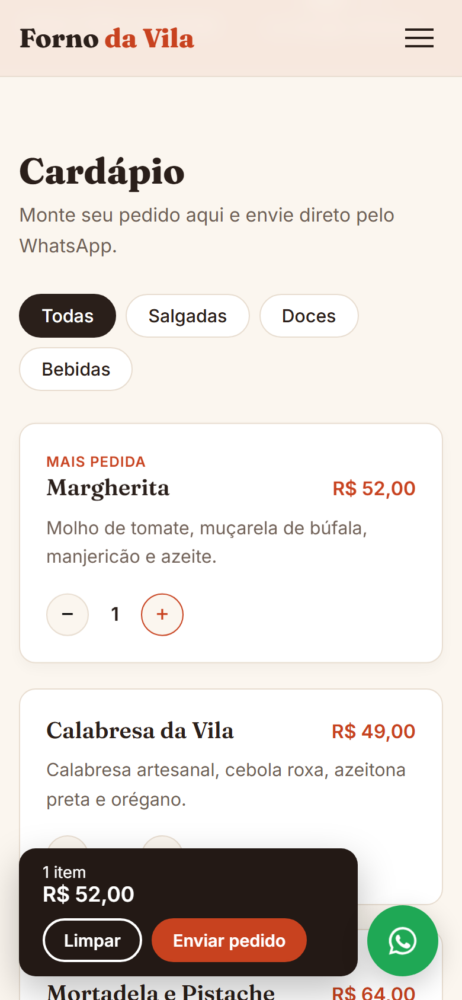

# Landing Page: Forno da Vila (Pizzaria)

Site de uma pizzaria fictícia feito com **HTML, CSS e JavaScript puros**, sem framework. O cliente monta o pedido no cardápio e envia pronto pelo WhatsApp com um clique.

🔗 **[Ver o site no ar](https://SEU-USUARIO.github.io/landing-page-pizzaria/)**

## Problema

Muitas pizzarias de bairro só têm Instagram. O cliente precisa pedir o cardápio por mensagem, esperar a resposta, perguntar preço por preço e digitar o pedido inteiro. A pizzaria perde tempo respondendo e perde cliente que desiste no meio.

## Solução

Uma página única, rápida e fácil de usar no celular:

- **Cardápio com filtro** (salgadas, doces, bebidas) e botões `+` / `−` em cada item.
- **Carrinho flutuante** que soma o total em tempo real.
- **"Enviar pedido"** abre o WhatsApp com a mensagem pronta: itens, quantidades e total.
- **Selo "Aberto agora / Fechado"** calculado pelo horário de funcionamento.
- **Botão flutuante do WhatsApp** sempre à vista.
- **Responsiva**: menu hambúrguer e layout em uma coluna no celular.

## Resultado

- O pedido chega **pronto e sem erro de digitação** no WhatsApp da pizzaria.
- O cliente vê preços e faz o pedido **sem esperar ninguém responder**.
- Hospedagem **gratuita** no GitHub Pages e nenhuma mensalidade de plataforma.

## Tecnologias

- **HTML** semântico e acessível (`aria-*`, `alt`, navegação por teclado)
- **CSS** com variáveis, Grid, Flexbox e `clamp()` para tipografia fluida
- **JavaScript** puro: cardápio gerado a partir de um array, carrinho com `Map`, link `wa.me` com a mensagem codificada

## Como usar em um negócio real

1. Em `script.js`, troque `WHATSAPP` pelo número da loja (ex.: `5511987654321`).
2. Edite o array `CARDAPIO` com os produtos e preços.
3. Ajuste `HORARIOS` com o horário de funcionamento.

## Rodar localmente

É só abrir o `index.html` no navegador. Ou, no VS Code, use a extensão **Live Server**.

## Publicar no GitHub Pages

No repositório: **Settings → Pages → Branch: `main` / pasta `/ (root)` → Save**. Em cerca de 1 minuto o site fica no ar.

---

Foto do topo: [Unsplash](https://unsplash.com/). Forno da Vila é um negócio fictício.
